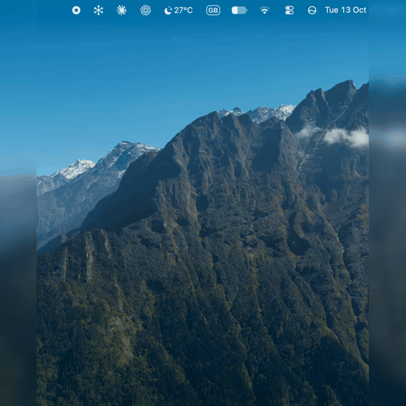

<div align="center">


# TCLimate

**Your TCL air conditioners, right in the macOS menu bar.**


</div>

TCLimate is an unofficial, native SwiftUI companion for TCL Home. Check room temperatures, adjust your ACs and track electricity use without reaching for your phone. It has no third-party dependencies, Dock icon or background service.

<div align="center">

</div>

## Features

- **Every AC in one panel.** A compact menu bar dropdown with a unit switcher and focused controls for the selected AC.
- **Quick control.** Power, target temperature (16–30 °C) and the reported indoor temperature.
- **Full controls when supported.** Auto, Cool, Dry, Fan and Heat modes; fan speed; vertical and horizontal airflow; Eco; sleep; display light; beep.
- **Electricity at a glance.** Today, yesterday and 7-day kWh, plus a 7-day bar chart. A missing reading is shown as a gap, never as a fake zero.
- **Stays current.** Refreshes when opened and every 30 seconds while visible. Commands are confirmed against the state the device reports.
- **Fits macOS.** Monochrome design that adapts to light and dark mode, optional Keychain sign-in and Launch at Login.

## Requirements

- macOS 14 Sonoma or later and internet access
- ACs already paired with a TCL Home account
- To build: Xcode Command Line Tools, Swift 6.0+, and an installed code-signing certificate

## Public beta

**v0.1.4 Public Beta** is available for macOS 14+ on Apple silicon and Intel. The universal app is Developer ID–signed, notarized by Apple, and includes a stapled notarization ticket.

[Download TCLimate v0.1.4 DMG](https://github.com/umarz317/TCLimate/releases/download/v0.1.4/TCLimate-v0.1.4-universal.dmg) · [ZIP alternative](https://github.com/umarz317/TCLimate/releases/download/v0.1.4/TCLimate-v0.1.4-universal.zip) · [Release notes and checksums](https://github.com/umarz317/TCLimate/releases/tag/v0.1.4)

Open the DMG and drag **TCLimate** onto the **Applications** folder shortcut. Eject the disk image, then open TCLimate from Applications. Click the snowflake in the menu bar to sign in. Enable Launch at Login after the app is in its final location. The DMG and app are both notarized and include stapled tickets.

If you prefer the ZIP, unzip it and move **TCLimate.app** to Applications before opening it.

## Build and install

To build locally:

```sh
swift test

# Find an installed signing certificate.
security find-identity -v -p codesigning

export TCL_CODESIGN_IDENTITY="Your certificate name or fingerprint"
./Scripts/build-app.sh
open "dist/TCLimate.app"
```

Alternatively, save the certificate name or fingerprint in `.codesign-identity`, which Git ignores. Sign every build with the same certificate. The script refuses ad hoc signing because that changes the app's Keychain identity on each rebuild.

For everyday use, quit TCLimate, move `dist/TCLimate.app` to `~/Applications` and open it from there. Turn on Launch at Login only after the app is in its final location.

## Getting started

1. Click the snowflake in the menu bar.
2. Choose your account region. Pakistan accounts use **Pakistan / Singapore**. Europe and United States are available but haven't been tested with live devices.
3. Enter your TCL account email and **TCL password**.
4. Optionally enable **Remember in Keychain** for automatic sign-in.

> [!IMPORTANT]
> If you sign in to TCL Home with Google, first set a TCL password under TCL Home › Account Security and use that here. Never enter your Google password; Google sign-in isn't supported.

ACs linked to the account appear automatically. Pair new units in the official TCL Home app, then refresh TCLimate.

## Using the panel

- **Unit switcher:** choose an AC when multiple units are linked.
- **Selected unit:** its power state, indoor temperature, and a power button.
- **Temperature:** − and + adjust the target in 1 °C steps while the unit is on.
- **Controls:** mode, fan, airflow, sleep and feature toggles. When collapsed it shows the current mode and fan speed.
- **Electricity:** daily kWh for the last 7 days. When collapsed it shows today's total.
- **⋯ menu:** Launch at Login, Sign Out and Quit.

Some options depend on the mode. Eco requires Cool, sleep requires Cool or Heat, and fan speed is unavailable in Dry. Changing mode clears Eco, Turbo and Sleep; changing fan speed clears Eco. Controls are disabled for offline or unreadable units.

## Privacy

- TCLimate talks directly to TCL's account and device services and to AWS IoT, over HTTPS. There is no project server and no analytics.
- With **Remember in Keychain** on, your email and TCL password are stored in the macOS Keychain. Session tokens and temporary AWS credentials stay in memory only.
- Sign Out removes the saved login.
- Signing in and loading devices or electricity data never changes AC settings.

When reporting a bug, never include passwords, tokens, device IDs or unredacted network captures.

## Compatibility

TCLimate relies on unofficial cloud APIs that TCL may change at any time.

| Area | Status |
| --- | --- |
| Sign-in, device discovery, state reads | ✅ Verified (Pakistan account, Split AC units) |
| Power and temperature | ✅ Verified through cloud-reported state |
| Electricity statistics | ✅ Daily kWh verified on two units via TCL Home 7's statistics API |
| Modes, fan, airflow, Eco, sleep, display, beep | 🧪 Implemented and unit-tested; not yet verified on hardware |
| Other AC models and regions | ❔ Not yet verified |
| LAN control, Google sign-in, live MQTT updates | — Not implemented |

A confirmed command means TCL's cloud reports the requested state. That is not independent proof of what the physical unit did.

## Development

```
Sources/TCLCore      Authentication, cloud requests, SigV4 signing, models, command mapping
Sources/TCLMenuBar   SwiftUI panel, Keychain, Launch at Login, menu bar icon
Tests/TCLCoreTests   Offline tests (no credentials or devices needed)
Scripts              App packaging, code signing, icon generation
```

```sh
swift build
swift test
./Scripts/build-app.sh
```

GitHub Actions runs the offline tests on macOS. Packaging is local only, because it needs your signing certificate. For universal Developer ID builds and notarization, see [Docs/Releasing.md](Docs/Releasing.md). Protocol and validation notes are in [Docs/Investigation.md](Docs/Investigation.md).

Keep only one installed copy when configuring Login Items.

Contributions are welcome, especially compatibility reports for other models and regions, accessibility improvements and installation polish. Include your macOS version, AC model, region and the sanitized error message.

## License and credits

[MIT](LICENSE). The international TCL Home protocol implementation draws on [nemesa/ha-tcl-home-unofficial-integration](https://github.com/nemesa/ha-tcl-home-unofficial-integration). Its attribution and license are kept in [THIRD_PARTY_NOTICES.md](THIRD_PARTY_NOTICES.md).

TCLimate is an independent project, not affiliated with or endorsed by TCL. TCL and TCL Home are trademarks of their respective owners.
